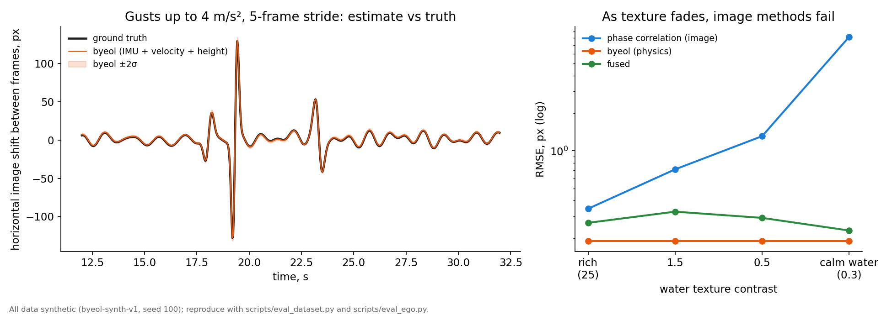

# byeol — фізична оцінка руху камери для рятувальних дронів

[English](README.md) · **Українська**

[](LICENSE)




*Ліворуч: зсув зображення між кадрами, який byeol передбачає за IMU, швидкістю та висотою (помаранчева лінія зі смугою ±2σ), повторює істину (чорна) навіть під час поривів. Праворуч: коли поверхня води втрачає текстуру, похибка оцінки за зображенням (фазова кореляція) зростає на порядки, а фізична оцінка не змінюється. Лише синтетичні дані.*

> **Відповідальне використання.** byeol створено, щоб допомагати знаходити людей у небезпеці: після повеней, на воді, у лісі, в зонах лих. Перед використанням прочитайте [ETHICS.uk.md](ETHICS.uk.md). Там сказано, для чого ми це зробили і для чого просимо цим не користуватися.

**byeol** (별, «зірка» корейською) оцінює, як зміщується зображення камери дрона між двома кадрами відео. Результат — піксельний зсув `(dx, dy)` із коваріацією 2×2. Оцінка береться **з власних датчиків дрона**: IMU, оцінки швидкості від польотного контролера, висоти над поверхнею та кута підвісу.

Методи «з картинки» (фазова кореляція, оптичний потік) погано працюють над відкритою водою. Там мало текстури, є відблиски сонця й хвилі. Саме там найважче супроводжувати людину у воді, і саме там відбуваються рятувальні операції. byeol бере рух камери з фізики, тому оцінка не залежить від того, що бачить камера. Візуальний трекер може використати її, щоб утримувати кандидата в кадрі.

| | |
|---|---|
| **Що це** | Детермінований оцінювач: фільтр орієнтації Mahony + фільтр Калмана для швидкості + точна гомографія площини + лінійне розповсюдження невизначеності |
| **Чим це не є** | Це не навчена модель. **Навчених ваг немає.** byeol не керує дроном і не входить у жоден контур безпеки польоту. |
| **Залежності** | Ядро — лише `numpy`. OpenCV/SciPy/PyYAML опційні (оцінка, калібрування, YAML-профілі). |
| **Цільове залізо** | Клас Raspberry Pi Zero 2 W. Це лише оцінка: ~3,7 % одного ядра настільного ПК, на Pi ще не виміряно. |
| **Зрілість** | Дослідницька версія (v0.1.0). Перевірено **лише на синтетичних даних**. Реальних польотів ще не було. Див. [Обмеження](#обмеження). |
| **Ліцензія** | [MIT](LICENSE). Під MIT код, конфігурації, результати й синтетичний датасет. |

## Зміст

- [Швидкий старт](#швидкий-старт)
- [Як це працює](#як-це-працює)
- [Результати (синтетика)](#результати-синтетика)
- [Склад релізу](#склад-релізу)
- [Датасет byeol-synth-v1](#датасет-byeol-synth-v1)
- [Обмеження](#обмеження)
- [Документація](#документація)
- [Цитування](#цитування) · [Внесок](#внесок) · [Ліцензія](#ліцензія)

## Швидкий старт

```bash
git clone https://github.com/sashapiscivca-svg/byeol.git && cd byeol
pip install -e .            # ядро: лише numpy
pip install -e ".[dev]"     # + тести, OpenCV, SciPy, PyYAML
python -m pytest tests -q   # ~120 тестів, 1–4 хв
```

Мінімальний приклад. Усі входи — в одиницях SI, світ NED, тіло FRD, один годинник для всіх потоків:

```python
import numpy as np
from byeol.cameramodel import CameraModel
from byeol.estimator import EgoConfig, EgoEstimator, HeightSource

cam = CameraModel.from_fov(640, 360, hfov_deg=70)          # або byeol.camprofile.load_camera("configs/cameras/....yaml")
est = EgoEstimator(EgoConfig(camera=cam, height_source=HeightSource.FUSED_FC))

# Подавайте потоки в порядку часу, як вони надходять:
est.push_imu(t, gyro_frd_rad_s, accel_frd_m_s2)              # 100–400 Гц
est.push_velocity(t, v_ned_m_s, sigma=0.2)                   # ОБОВ'ЯЗКОВО, 5–10 Гц (EKF польотного контролера)
est.push_height(t, h_m)                                      # 5–10 Гц, висота над поверхнею, яку знімаємо
est.push_gimbal(t, theta_rad)                                # 0 = вперед/горизонт, pi/2 = надир
est.push_heading(t, yaw_rad)                                 # опційно, 2–5 Гц

r = est.frame_shift(t_prev_frame, t_cur_frame)
if r.valid:
    print(r.dx, r.dy, r.cov, r.conf)                         # пікс, пікс, 2x2 пікс^2, (0, 1]
else:
    print("оцінки немає:", r.reason)                         # напр. no_velocity, no_height, horizon
```

`r.valid == False` — навмисна чесна відмова. byeol не повертає тихо погану оцінку. Повний інтерфейс описано в [docs/INTEGRATION.uk.md](docs/INTEGRATION.uk.md): системи координат, знаки, одиниці, коди відмов, злиття з фазовою кореляцією.

Відтворення опублікованих чисел:

```bash
python scripts/make_dataset.py --check   # перегенеровує byeol-synth-v1 у пам'яті й перевіряє збіг біт-у-біт
python scripts/eval_dataset.py           # проганяє оцінювач на файлах датасету (~8 хв, одне ядро)
python scripts/eval_ego.py               # повна оцінка E-001/E-002 з базою фазової кореляції (потрібен OpenCV)
```

## Як це працює

```
 IMU (гіро, акселерометр) ──► фільтр Mahony ──► нахил (нормаль площини) ───────────────┐
        │                    (оцінка зсуву нуля гіро)                                    │
        └──► інтегрування гіро (без зсуву нуля) ──► відносний поворот R01 ──────────────┤
 швидкість ПК (NED) ──► фільтр Калмана швидкості ──► ∫ v dt = зсув камери t01 ──────────┤──► точна гомографія площини ──► (dx, dy)
 висота над поверхнею ──────────────────────────► відстань до площини d ────────────────┤      для опорного(-их) пікселя(-ів)
 кут підвісу ───────────────────────────────────► поворот камера→тіло ─────────────────┘
                                                        числовий якобіан (10 параметрів) ──► коваріація 2×2, conf
```

1. **Орієнтація.** Комплементарний фільтр Mahony інтегрує гіроскоп, коригує нахил за акселерометром і оцінює зсув нуля гіроскопа. Корекцію акселерометром вимкнено, коли `|f| ≠ g`, а сам сигнал проходить НЧ-фільтр проти вібрації.
2. **Швидкість.** Лінійний фільтр Калмана на 6 станів оцінює швидкість у світі й зсув нуля акселерометра. Його оновлює оцінка швидкості від польотного контролера. **Цей вхід обов'язковий**: подвійне інтегрування акселерометра дрейфує за секунди. Без нього результат буде `valid=False`.
3. **Геометрія.** Для кожного опорного пікселя: промінь у кадрі *t₀* → перетин із площиною поверхні (висота `h`, нормаль з орієнтації й підвісу) → перенесення в кадр *t₁* → проекція. Це точна гомографія площини без лінеаризації малих кутів. Поворот, поступальний рух і зміна підвісу обробляються одним кодом.
4. **Невизначеність.** Числовий якобіан за 10 параметрами (поворот 3, зсув 3, висота 1, нормаль 3) розповсюджує похибки: шум гіро, залишковий зсув нуля, масштаб і синхронізацію, пропуски IMU, коваріацію швидкості, висоту й нахил, плюс «підлогу» моделі. `conf = 1 / (1 + λmax(cov))`.

Деталі, рівняння й обґрунтування: [docs/TECHNICAL_REPORT.uk.md](docs/TECHNICAL_REPORT.uk.md), [docs/DESIGN_DECISIONS.uk.md](docs/DESIGN_DECISIONS.uk.md).

## Результати (синтетика)

Усі числа нижче отримано на **синтетичних даних** власного генератора byeol. Умови: камера 640×360, f = 457 пікс, висота 30 м, підвіс 75°, IMU 200 Гц, 30 к/с, 3 seed × 40 с на сценарій, перші 10 с відкинуто. Числа показують поведінку методу в контрольованих умовах. **Це не міра якості в реальних польотах.**

**Фізика проти істини (експеримент E-001).** Похибка в пікселях у центрі кадру. «Нуль» — база «камера не рухалась».

| Сценарій | RMSE, крок 1 | ≤1 пікс, крок 1 | RMSE, крок 5 | ≤1 пікс, крок 5 | RMSE «нуль» (крок 5) |
|---|---|---|---|---|---|
| висіння (хитання) | 0,08 | 100 % | 0,35 | 100 % | 8,30 |
| політ 5 м/с | 0,08 | 100 % | 0,34 | 99,6 % | 14,54 |
| пориви до 4 м/с² | 0,14 | 100 % | 0,67 | 85,9 % | 19,82 |
| вібрація 70 Гц | 0,15 | 100 % | 0,43 | 99,7 % | 8,30 |
| шум IMU ×10 | 0,40 | 99,8 % | 1,08 | 59,2 % | 23,57 |
| зсув нуля гіро 0,05 рад/с | 0,32 | 100 % | 1,58 | 54,9 % | 14,54 |
| пропуски IMU 3 % | 0,77 | 88,1 % | 2,53 | 37,5 % | 23,57 |
| політ **без швидкості ПК** | — (`valid=False` за задумом) | 0 % | — | 0 % | 14,54 |

**Фізика проти фазової кореляції над синтетичною водою (E-002, крок 1).** Фізика не залежить від текстури: 0,19 пікс RMSE і 100 % кадрів ≤1 пікс за будь-якого контрасту. Фазова кореляція гіршає зі зниженням контрасту: контраст 25 — 0,34 пікс / 97,5 %; контраст 1,5 — 0,71 пікс / 86,5 %; контраст 0,5 — 1,31 пікс / 44,4 %; контраст 0,3 — 8,19 пікс / 24,2 %.

**Де byeol *не* допомагає.** На добре текстурованій сцені картинка й так хороша. При 30 к/с з трекером рух між кадрами малий, і варіант «без руху камери» працює не гірше. При 3 % пропусків IMU чесна невпевнена оцінка byeol програє картинці з добре налаштованою брамкою. Усе це описано в [docs/TECHNICAL_REPORT.uk.md](docs/TECHNICAL_REPORT.uk.md), §5.

Сирі результати: [`experiments/`](experiments/).

## Склад релізу

```
src/byeol/          оцінювач (numpy) + синтетичний генератор, метрики, моделі камер, конвертери одиниць/систем/часу
configs/cameras/    7 параметричних шаблонів камер (RGB і тепловізійні LWIR); ілюстративні, не характеристики виробників
scripts/            оцінка, аналіз чутливості, CLI калібрування, збирач і оцінювач датасету, бенчмарк CPU
experiments/        збережені результати E-001…E-006 (JSON + таблиці Markdown)
data/byeol-synth-v1 синтетичний бенчмарк: 21 послідовність, сирі потоки датчиків + істина (15 МБ, MIT)
tests/              модульні, аналітичні й реплей-тести
docs/               технічний звіт, посібник з інтеграції, рішення, карта модулів, огляд сторонніх даних (EN + UK)
```

**Навченої моделі для завантаження немає**: byeol — це сам алгоритм. Репозиторій моделі на Hugging Face містить картку моделі ([MODEL_CARD.uk.md](MODEL_CARD.uk.md)) і профілі камер. Датасет опубліковано окремим датасетом Hugging Face.

## Датасет byeol-synth-v1

Детермінований бенчмарк із фіксованими seed: 7 сценаріїв польоту × 3 seed × 40 с. Кожна послідовність містить:

- сирі потоки: IMU (200 Гц), швидкість (10 Гц) і курс (5 Гц) від польотного контролера, висоту (10 Гц), кут підвісу для кожного кадру, моменти кадрів (30 к/с);
- істину: позицію, швидкість, кватерніон орієнтації, істинну висоту, істинний зсув нуля гіро та істинний піксельний зсув для кроків 1 і 5.

`scripts/make_dataset.py` перегенеровує датасет біт-у-біт. Картка датасету: [data/byeol-synth-v1/README.md](data/byeol-synth-v1/README.md).

Ті самі файли опубліковано на Hugging Face Hub: [alexshynkarenk0/byeol-synth-v1](https://huggingface.co/datasets/alexshynkarenk0/byeol-synth-v1) (MIT, 15 МБ, тег `v1`). Картка моделі та профілі камер — у [alexshynkarenk0/byeol](https://huggingface.co/alexshynkarenk0/byeol) (ваг немає: byeol — це алгоритм).

```python
from huggingface_hub import snapshot_download
path = snapshot_download("alexshynkarenk0/byeol-synth-v1", repo_type="dataset", revision="v1")
# python scripts/eval_dataset.py --data <path>
```

## Обмеження

Прочитайте це, перш ніж покладатися на byeol. Повний перелік — у [MODEL_CARD.uk.md](MODEL_CARD.uk.md) і технічному звіті.

- **Немає перевірки в реальному світі.** Не було ні реальних польотів, ні реального IMU, ні реального відео. Усі числа отримано на нашому генераторі, який має спільні геометричні припущення з оцінювачем. Тому результати — **верхня межа**.
- **Модель рівної поверхні.** Хвилі, рельєф, берег і об'єкти над площиною не враховано. Над водою сама поверхня рухається.
- **Обов'язкова швидкість від польотного контролера.** Без неї byeol відмовляє (`valid=False`).
- **Не моделюються:** роллінг-шаттер, лаг і власне хитання підвісу, плече IMU–камера, розсинхронізація камери й IMU понад ~3 мс, об'єктиви «риб'яче око».
- **Шумові параметри — припущення.** Їх не калібрували на залізі. Бюджет на Raspberry Pi — екстраполяція, а не вимір.
- **byeol — помічник, а не арбітр.** Він живить трекер, а рішення приймає людина. Його ніколи не можна ставити в контур керування польотом чи безпеки.

## Документація

| Документ | English | Українська |
|---|---|---|
| Технічний звіт (метод, експерименти, обмеження) | [docs/TECHNICAL_REPORT.md](docs/TECHNICAL_REPORT.md) | [docs/TECHNICAL_REPORT.uk.md](docs/TECHNICAL_REPORT.uk.md) |
| Посібник з інтеграції (API, системи координат, одиниці, коди відмов) | [docs/INTEGRATION.md](docs/INTEGRATION.md) | [docs/INTEGRATION.uk.md](docs/INTEGRATION.uk.md) |
| Проєктні рішення D-001…D-021 | [docs/DESIGN_DECISIONS.md](docs/DESIGN_DECISIONS.md) | [docs/DESIGN_DECISIONS.uk.md](docs/DESIGN_DECISIONS.uk.md) |
| Картка моделі | [MODEL_CARD.md](MODEL_CARD.md) | [MODEL_CARD.uk.md](MODEL_CARD.uk.md) |
| Картка датасету | [data/byeol-synth-v1/README.md](data/byeol-synth-v1/README.md) | (двомовна) |
| Огляд сторонніх датасетів і симуляторів | [docs/THIRD_PARTY_DATA.md](docs/THIRD_PARTY_DATA.md) | (двомовний) |
| Карта модулів | [docs/MODULES.md](docs/MODULES.md) | (двомовна) |
| Відповідальне використання | [ETHICS.md](ETHICS.md) | [ETHICS.uk.md](ETHICS.uk.md) |

## Цитування

Див. [CITATION.cff](CITATION.cff) або BibTeX в [англійському README](README.md#citing).

## Внесок

Ми раді внескам. Найцінніше, що ви можете дати, — реальні записи польотів під вільною ліцензією. Саме їх проєкту бракує найбільше. Див. [CONTRIBUTING.uk.md](CONTRIBUTING.uk.md). Про вразливості й зловживання повідомляйте за [SECURITY.uk.md](SECURITY.uk.md).

## Ліцензія

[MIT](LICENSE) © 2026 The byeol Authors. byeol — частина набору *uju* відкритих інструментів для рятувальних дронів, разом із *hae* (виявлення людей) і *dal* (трекінг). Ці проєкти публікуються окремо.
